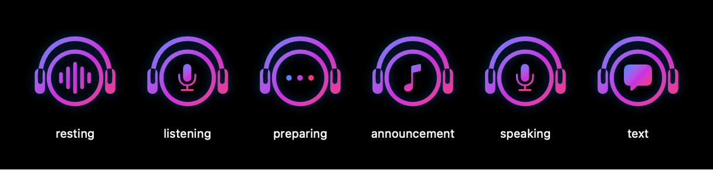

# DJ Persona avatar — first Apple graphics slice

Owner: [Apple #127](https://github.com/pcvantol/djconnect-app/issues/127).
Canonical design: [Core #1209](https://github.com/pcvantol/djconnect/issues/1209),
including the later headphone/full-ring refinement of 18 October 2026.

## Admitted scope

This first slice is the local, static visual identity and in-place integration.
`DJPersonaMark` is the single native vector source: a complete round pulse ring,
anchored headphone headband, rounded earcups and five central waveform bars.
The 26-point template menu image is rendered from exactly that geometry; sidebar,
SwiftUI tabs, UIKit bottom tabs and Session status icons share the same mark.
No screenshot raster is used as an asset. Artwork's turntable/tonearm fallback is
untouched. Watch remains separate. WidgetKit/ActivityKit now compile this same
vector view directly, without linking the app UI module. Their avatar uses only
the already admitted, expiring surface mood palette; compact/minimal Island and
rich/fallback widget/activity layouts share it. The redundant expanded Island
leading icon is removed. An expired/stale Activity uses brand colors.

This passive presentation update does not export foreground capture, pending
Ask DJ or speech activity. The passive contract does not carry those lifecycle
observations; listening/thinking/speaking glyphs remain pending the qualified
Core handoff. A colored avatar is not a claim of continuous background updates.

`NativeSessionMomentsView.currentCard` is now the single persistent material
container. Its avatar and existing content are children of that same container,
not sibling cards. All unavailable/recovering/paused/Moment/quiet/start branches
keep their messages, controls and accessibility identifiers. MomentCard's former
inner material/padding moves to that common parent, preserving exactly one
border/material. The header's artwork stays outside this container. No history
row, backend Moment, private content or provider request is added.

Mood only selects the existing confirmed Session palette. Unknown or recovering/
unavailable state uses neutral brand colors. No artwork-derived mood, local Mood
setting or additional Persona is created. The native graphic has one localized
VoiceOver identity; it does not claim to listen, think or speak. It is static, so
Reduce Motion and low-power mode need no repeating timer. Reduce Transparency
uses an opaque core/no glow; increased contrast uses white geometry. Menu uses
monochrome template rendering at its native size.

## Not yet admitted / still OPEN

This is not the completed living-avatar assignment. Core's semantic/capability
handoff is still pending after its migration recovery. Dynamic inner glyphs,
voice/text distinction, actual speech start/stop, announcement persistence,
touch reactions, gesture arbitration, temporary overlays and generative/audio
routes remain unwired. No speculative local fallback quips, fake Ask DJ turn,
Speaking animation or inferred microphone activity is shipped by this slice.
Before those consumers start, pin and review Core's actual typed observations,
fixtures, privacy/Presence boundaries and lifecycle contract. In particular,
Silence and music_only cannot invent or re-enable proactive speech.

## Validation boundaries

Native vector bounds are checked at16/20/24/80pt and in non-square icon slots.
A native ImageRenderer check exports the five palette variants, tiny menu marks
and increased-contrast/static representation for inspection. The new native UI
test checks exactly one avatar inside the existing current card before/after a
demo chat interaction. Compilation or a component contact sheet is not a native
screen/real-device acceptance result; record whether that UI test actually ran.
Independent source/design review, protected delivery and separate Finalization
remain required. No production Store release or backend deployment is selected.

## Reviewed native graphics renders

These images were generated by the native SwiftUI renderer from the source
component and direct current-card function. Current-card renders use the real
opaque material fallback (Glass effects off). They bypass the periodic host
because ImageRenderer does not draw TimelineView content. Initial unsupported
host renders were rejected and remain only in ignored local diagnostic output.
These are demo fixtures, not physical device or interaction acceptance.

- [Quiet](assets/dj-persona-graphics/session-current-quiet.png)
- [Paused](assets/dj-persona-graphics/session-current-paused.png)
- [Recovering](assets/dj-persona-graphics/session-current-recovering.png)
- [Unavailable](assets/dj-persona-graphics/session-current-unavailable.png)

Focused native checks:3 tests/10 parameter cases PASS. The full application UI
test is added but NOT_RUN: no local simulator devices are available on this host.
Native iOS/macOS compilation and strict signatures pass with build40348.
Full regression:861 tests/10 suites PASS92.751s. The iOS UI test compiles but has
not run. Local HTTP/WebSocket/security/localization/brand/register/install-hygiene
checks pass;243 staged build inputs match the candidate. Independent automated
review completed without findings on candidate `5d661066dc6b113a3723c09099c3700eb6692e21`.
[PR130](https://github.com/pcvantol/djconnect-app/pull/130) protected-merged as
`d95d3c3ebc8aae153c04d0bb3c5ce512a8afa3c5`; candidate/main tree equality was
verified. Main CI39167432496 and formal run39168031661 PASS. The durable source asset
and canonical JSON integrity were independently verified (12/12 formal checks).
See docs/verification/avatar-graphics-finalization/. Documentary protected
delivery remains pending; these receipts do not close the full avatar assignment. No physical
installation, full-screen UI acceptance or completion of Apple127 is claimed.

## 19 October continuation — observed foreground activity

Core1215/1216 qualify existing owner signals; Core1217/1218 deliver the separate
touch producer. Read-only comparison of Core main
`f8b28d2b3713ae0bfe11a44d32634d821c914cc8` against the running HA-dev container
matches all205 regular integration files. This supersedes the historical
not-yet-delivered prerequisite above for basic activity only. No new backend
contract is invented by this consumer.

The foreground current-card avatar now resolves capture, request/preparation,
qualified observed-playback announcement, actual shared speech and accepted text.
All local observations bind the active Session, authorized owner response epoch,
Broadcast connection generation and confirmed settings binding. Actual recorder
and player state is read; optimistic recording/playing flags and remote speaker
acknowledgements cannot animate speaking. Manual replay and autoplay both use the
same observed AVAudioPlayer. Audio preparation uses dots; actual capture has an inward halo and actual
audio has an outward halo inside the anchored ring, and stop/failure/expiry/interruption returns to the remaining valid
presentation. The same spoken announcement keeps its note; an unrelated spoken
turn or newly accepted reply cannot be masked by an older announcement. Generic
track stories cannot select the note: type, intent, observed-playback provenance,
exact source references and native admission must all match.

Intentional Silence and music_only default to rest when no genuine current
interaction/audio takes priority. The decoder preserves the existing optional
current_silence_moment_id; a new silence identity invalidates an older text
presentation without inventing content or an audio grant. Conflicting current
Moment/Silence authority cannot select current announcement content.

The anchored outer geometry stays stable. Six glyph meanings have localized
VoiceOver values in all five languages. Reduce Motion, low-power and serious /
critical thermal state suppress pulse effects. Reduce Transparency/contrast and
all current card messages/actions remain intact. No extra Flow timer is added:
the existing current-card clock evaluates expiry/player state, while SwiftUI's
bounded symbol effect runs inside the avatar. Passive surfaces default to static
rest and never consume these foreground observations.

Touch gestures/overlays/reaction synthesis remain the next separate consumer
slice. Real microphone/real speaker output and physical installed acceptance
remain OPEN; unit/native renders and unsigned compilation do not establish them.
The existing UI-test runner initialization limitation is not reclassified as PASS.

Native component render (static glyphs; this image does not demonstrate live audio):

