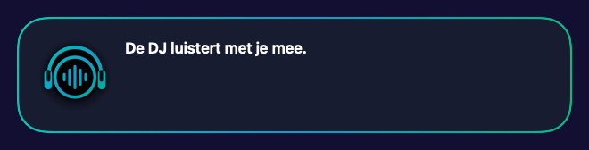
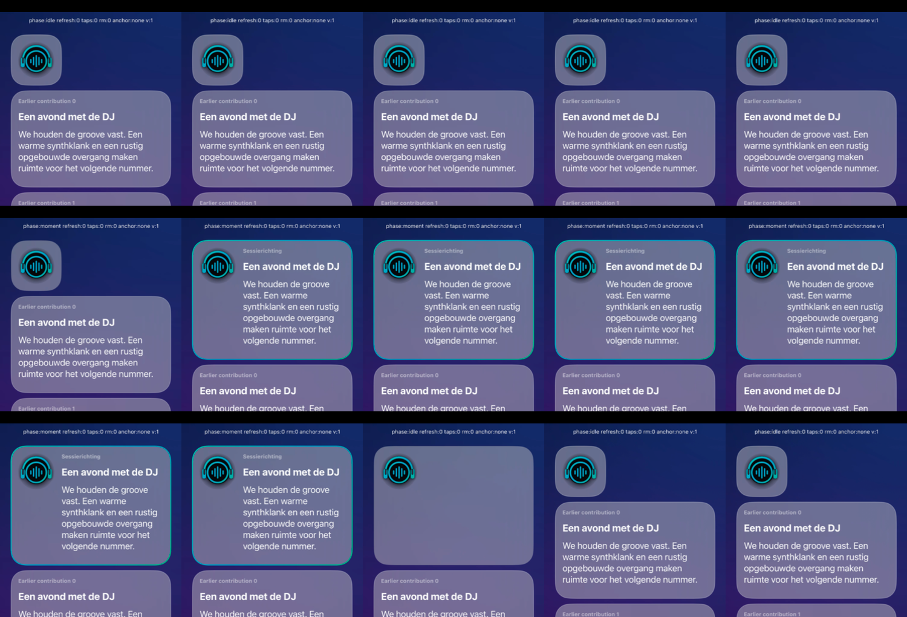

# Compact current Session DJ-avatar

Owner-requested addition to the existing Apple writer/register #87 and draft PR #295. This is current-Session/avatar presentation only: no Core contract, start-without-music/“Verras me” action, VibeScape, widget, Live Activity, release or installation change.

## Behaviour and source boundary

`NativeSessionMomentsView` still selects content through `nativeCurrentMoment(at:)` and the existing local-withdrawal guard. Speech completion or a text-only setting never selects idle. A coherent active/playing Session with explicit native no-current/silence now uses a 112 × 112 glass tile around the unchanged 80 × 80 avatar and a central 16-point inset. The tile has the ordinary subtle glass outline, no idle text and no expanding frame/minimum height. A valid contribution expands that same shared card. Avatar position, callback, multi-tap/context-menu/keyboard/accessibility handling and Mood colouring are retained.

The UI-only `SessionCurrentDJCardState` distinguishes confirmed compact/expanded geometry from unresolved delivery. Missing/foreign/malformed delivery, missing body/admission, conflicting current/silence identities, duplicate/reordered or unqualified admissions and malformed supplied deadlines cannot manufacture idle. Existing, unambiguous original presentation/source expiry and confirmed local withdrawal may end presentation without waiting for another snapshot. The existing content admission remains the sole gate for all text; this geometry classifier does not grant content, extend a lease or introduce a timeout.

An unresolved update preserves only the last measured format/height, bound to this `sessionID`, never the previous content. Unknown initial/new-session geometry starts expanded. This records the concrete delivery distinction at the existing Apple owner: a current ID with missing body/admission is incomplete data, not proof that the DJ has nothing to show. No new backend state or endpoint is inferred.

Pause, reconnect/unavailable feedback and the existing no-music start flow remain expanded. An ended Session does not qualify for compact idle; the actual parent Session-end route remains responsible for removing the active projection. Existing historical Flow identities, ordering, retention and content are unchanged. The unused visible `ui.session.quiet` key was removed from all five locales; historical evidence/tests were preserved.

## Identity, motion and reading position

One `SessionCurrentDJCard` holds the same structural avatar position across both formats. Fixed leading/top insets anchor it. Native glass uses one stable tint-capable node rather than separate tint/no-tint ancestor branches; accessibility containment preserves the avatar as its own child even when it is the only content. A finite numerically animatable layout grows from the intrinsic tile to the pane width, measures detail at its final width and keeps the avatar fixed. Its session-bound layout cache retains only expanded height while detail disappears. The standard reduced-motion policy disables the 0.2-second layout animation. The final clip uses the same central 32-point rounded shape as the frost.

Native testing found a real 151.666-point history-row displacement when the current card resized above the viewport. The no-op control stayed stationary, while autonomous contribution delivery reproduced the displacement. General bottom/size-change anchoring and a nil scroll anchor were investigated only in the qualification host and **not adopted**.

The correction is local to the current card: while completely outside the scroll viewport, preserve its measured geometry. Native admission still withdraws invalid content immediately. Clip replacement content before the glass so it cannot overflow into Flow rows. On returning into view the same card takes the current source-selected shape. This offscreen reading compensation is not an idle minimum height: the visible idle tile remains intrinsically 112 × 112. No scroll command, anchor/follow-mode mutation, focus request or draft update was added to product code.

## Native before/after

These are real SwiftUI component renders in the opaque-glass fallback, not mockups. The current inset is shared by compact and expanded states; the avatar itself remains 80 × 80.

| Before | After |
| --- | --- |
|  |  |



The contact sheet samples the actual final iPhone simulator movie; diagnostic controls belong only to the qualification host. The recorded movie is `native-final-rounded-r4/iphone-idle-moment-idle.mov` (13.3 seconds); an iPad movie is retained alongside it.

Device screenshots, transition movies, accessibility hierarchies and test results are retained in external task evidence under `/Volumes/Shared Data/tmp/pcvantol/apple-suggestions-more-footer-20261102/avatar-idle-r1/`. The native host compiles the actual shared UI/Core source. Its explicit synthetic controls/records are test tooling, not additional product UI.

## Qualification

Final local qualification: **1,652 tests in 60 suites**, **57 targeted tests**, both unsigned app builds and **nine repository checks** pass. Native iPhone has **7 passing tests and 1 iPad-only skip**; iPad has **8 passing tests**, including actual landscape frame verification. Final native source SHA256 is `c9f644b0fbc5a190eb22931af286e69ee76ba4f003361125ccef19e2c691812d`; the test receipts report unchanged source. Relevant records:

- `avatar-idle-focused-final-r7-receipt.json`: 57 targeted tests, including 21 geometry-state cases, intrinsic 112-point sizing under 280/620/1200-point proposals, existing persona reaction/authority/cancellation/expiry regressions native render states, finite intermediate-frame geometry/visible avatar/transparent right edge, and a narrower pane while geometry is held.
- `avatar-idle-full-final-r4-receipt.json`: final full Swift regression suite.
- `avatar-idle-mac-build-final-r4.log` and `avatar-idle-ios-watch-build-final-r4.log`: unsigned product builds.
- `validation-avatar-idle-final-r4/logs-checks/results.json`: all nine required checks.
- `avatar-idle-r1/native-final-rounded-r4`: final native matrix, screenshots, movies, accessibility hierarchies and unchanged read-ID checks. iPhone row 5 remains exactly 674.708333 points across no-op, autonomous expansion and compaction; iPad row 10 remains exactly 585.875 points. Its older debug logging key still says `ROW5`; the test explicitly chooses row 10 on iPad and checks header visibility before measuring. All owned simulators were shut down and deleted successfully.
- `avatar-idle-r1/independent-review-final-r4.json`: read-only source/component review, separately from protected GitHub approval.

Earlier failures remain intact: the initial native run revealed inherited accessibility identifiers, and the first reading runs exposed the actual layout displacement. The first large-iPad “offscreen expanded” test did not scroll because its chosen row was already visible; the corrected test explicitly requires the header to be outside the viewport before measuring. The 2-point position assertion remains unchanged. Frame inspection subsequently found a nil/infinite-frame animation flash and rectangular corner bleed; finite numeric interpolation, identity removal of unadmitted detail and the matching rounded clip corrected both. A bare ImageRenderer intermediate-frame probe was replaced by the actual leading pane context, with unchanged intrinsic tests plus stricter edge/height/avatar pixel assertions. All earlier runs remain available; no failed run was relabelled as successful.

The device component matrix covers idle→valid text→partial→text→idle, repeated unchanged refreshes, one avatar, initial/new-session geometry, offscreen expanded→idle and return, preserved draft/keyboard focus, real native multi-tap component callbacks in both formats, iPad rotation, large Dynamic Type and the actual simulator System Reduce Motion setting. Mac native rendering covers narrow/wide geometry. Independent read-only source/evidence review is recorded separately from protected GitHub approval.

Reproduce the native component matrix with a fresh external output root and an existing qualified JOSESwift checkout:

```sh
python3 Tools/qualification/session-idle/run_native.py \
  --output-root "$IDLE_OUTPUT_ROOT" \
  --jose-checkout "$JOSE_SWIFT_CHECKOUT"
```

The tool creates and deletes only its own temporary simulators. Optional `--derived-data`/`--project-root` reuse its isolated build cache; `--device`/`--only-testing` support bounded diagnosis. No Home Assistant/provider operation, hardware music output, microphone or installed-user-device session is involved.

## Acceptance limits

This establishes native component behaviour and source regressions. The tap probe counts the unchanged input component's callback; it does not claim a real paired producer reaction. Accessibility labels/containment/hierarchies were tested, but actual VoiceOver spoken navigation on installed hardware was not. Large text uses the real SwiftUI Dynamic Type environment, while Reduce Motion is changed through Settings on the owned simulator. There is no physical iPhone/iPad/Mac installation, real provider/TTS acceptance, merge or deployment claim. Protected exact-head source review and hosted CI remain separately reported.
