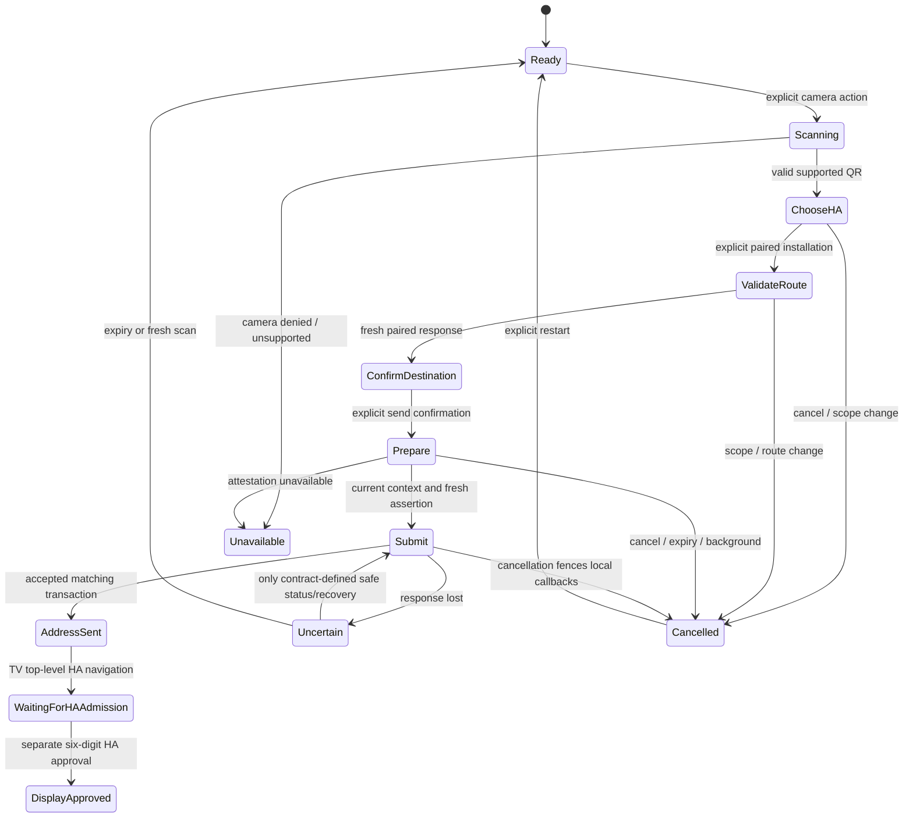

# Apple scanner consumer review — code-free route A

Assignment: `DJC-APPLE-VIBECAST-OWNER-SCANNER-V1-20261016`.
Status: **CONSUMER_REVIEW_DELIVERED / A_CONTRACT_NOT_FROZEN / NO_RUNTIME_START**.
Existing sole writer `codex/apple-dj-presence-v1`, source inspected at
`1e8ecf2`. This increment contains documentation and non-wire design fixtures.
Unrelated source/project WIP and pending physical WebSocket tests are preserved.

## Exact inputs and decisions

- API94 `e6464e86cd214bd55661f14f238706332a53bd40`, revision0.2.0-draft.
- Core1197 current head `325aabc7205f1f18928bc2c809817956d91609f8`.
- Earlier B runtime `951da5d0` and actual-transport fixture pin `0f3d6402`
  remain separately identified; they are not installed/native proof.
- Owner corrections Apple87/6224544732,6224664239,6224670726 supersede extra
  PAKE/OOB/comparison-code UX. There is only the existing six-digit HA admission.
- Step A transfers an address. Step B separately authorizes the display. Neither
  scanner success, attestation, redirect nor B capability implies display access.

## Actual Apple source interface

| Existing source | Verified behavior | Consumer consequence |
| --- | --- | --- |
| `DJConnectClient.pair`, lines72 onward | Saves returned device token in injected token store | Reuse existing app-to-HA relationship; no re-pairing for scanner |
| `DJConnectModels.DJConnectPairingResponse`, lines587 onward | `ha_remote_url`, `ha_install_id` and existing identity metadata | Cached metadata identifies a candidate, not fresh scan-time authority |
| `DJConnectAppModel.apply(pairingResponse:)`, lines5011 onward | Persists one local/remote configuration and bootstrap install ID | Present the actual configured installation explicitly; no invented multi-install registry or silent last-used selection |
| `DJConnectClient.makeAuthenticatedRequest`, lines1454 onward | Bearer Authorization plus existing client/device headers | Use only toward selected HA; dedicated destination read must not encode legacy token-bearing identity into the JSON body |
| `DJConnectHybridTransport.qualify`, lines282 onward | Authenticated transport context must equal expected `ha_install_id` | Keep this installation fence before owner-context read; process-local B epoch cannot replace install identity |
| `DJConnectAppModel.revalidatePairedIdentity`, lines5974 onward | Checks request generation, configuration and unchanged token around awaited status reads | Reuse principle, but scanner needs its own monotone flow invalidation rather than values-only equality that could permit ABA |
| `DJConnectAppModel.normalizedHomeAssistantURL`, lines12360 onward | Generic HTTP/HTTPS parser trims input and permits broad routes | Not a valid A raw-destination validator; do not normalize hostile input into an accepted route |

No scanner/display-owner-context or App Attest implementation exists in the
inspected Apple source. Existing token-store implementations are not a new
App Attest storage policy. This review changes neither token storage nor pairing.

Proposed producer-backed read: `POST /api/djconnect/v1/display/owner/context`
with Authorization only toward HA and exact JSON
`{"contract_version":1,"identity":{"client_type":"ios","device_id":"existing-paired-device"}}`.
Native absent Origin follows Core's authenticated policy; never forge browser
Origin. Require discovered supported B contract and current paired authority.
Take `display_entry_url` only from this accepted current response, validate its
raw canonical form against the shared corpus, then show its actual HTTPS host
and chosen installation. No pasted/QR/Host-derived route or local-IP fallback.
These candidate endpoints are not assumed deployed on HA-dev/prod.

Capture flow generation, selected installation, client/token generation, current
Profile scope/revision, configured route and original QR transaction/browser
key/generation/expiry. Invalidate on any pairing/Profile/install/configuration
change, background/cancel/rotation or expiry, including change-and-return (ABA).
After each await, before assertion and before submission, recheck flow generation;
repeat the pure owner-context read at the release boundary. If route/issuer epoch
changed, discard preparation and require explicit reconfirmation. Never acquire
new authority from an old callback. An address released before revocation cannot
be recalled; B must still freshly authorize its separate admission.

## App identity, support and distribution

Signed local40208 iOS product readback: application identifier
`ZEML4LPXH4.dev.djconnect.ios`, TeamID `ZEML4LPXH4`, bundle `dev.djconnect.ios`,
Apple Development/get-task-allow true. No App Attest entitlement is present;
APNs development entitlement is unrelated. This proves only this signed local
product. Production prefix/environment/registration must be read from the exact
future distribution artifact; do not infer App ID prefix solely from TeamID.

**Correction to API94 assessment:** its sentence saying not to treat Macs as
categorically unsupported conflicts with Apple's current `isSupported` page,
which explicitly returns false on Mac, including Catalyst and iOS/iPadOS on Apple
silicon. Runtime `isSupported` remains mandatory on supported iPhone/iPad targets.
No actual device support/attestation/assertion result was measured in this review.
Native Mac continues existing non-A routes and offers using the paired iPhone;
no unsigned scanner submission or borrowed phone assertion. Preserve the separate
local Cast-discovery entry and existing direct HA address route.

Design distribution policy: explicit development and production verifier domains;
no development allowlist in production. TestFlight/App Store/Enterprise operate
in production regardless of development entitlement. Exact registration, signing,
entitlement, distribution and any real-key enrollment require their own candidate
admission; nothing is changed in the Developer account by this review.

App Attest key ID is a separate install-local hardware/runtime handle, never an HA
identity, Profile credential or QR/browser encryption key. Do not sync or back up
it as portable authority. Apple says ordinary updates retain keys; reinstall,
migration and restore require starting over. Generate neither a key per QR nor
an unbounded replacement loop. Serialize assertions per key; after uncertain
counter use request a new challenge/assertion within the original QR deadline.
Unknown/invalid key and unsupported/outage states fail closed. A key reset never
creates or restores HA pairing. Finite server key/counter retention, deletion,
re-attestation and cross-DO crash ordering remain **KEY-STATE OPEN**; Apple does
not authorize a permanent registry or invent a retention period here.

## Code-free UX state model

The `DisplayApproved` state is entered only from actual B approval/collection,
never from A response. Native A UI says address sent / continue on TV, not
screen connected. Once submission may have committed, cancellation can abandon
local UI but must not claim the remote transaction was recalled. API must freeze
status/lost-response semantics; blindly resubmitting or consuming is forbidden.
Duplicate scan of the same active transaction does not submit twice; rotated QR
invalidates prior work. New QR requires explicit restart, not silent retry.

Camera permission is requested at explicit scan only, with accessible manual
restart/settings guidance after denial. Respect existing OS local-network policy;
no privacy prompt automation. One configured HA still gets visible confirmation;
multiple supported pairings require explicit choice. No paired HA means unavailable,
not guest-to-owner promotion. Show original expiry, actionable fixed errors and
actual HTTPS host with VoiceOver/readable layout. Translate all states in
en/nl/de/fr/es before runtime acceptance; no runtime/localization PASS claimed.

## Consumer decisions and remaining gates

1. **TRUST-1 OPEN:** accept only the limited statement that a verified app key
   reports checking its paired route. This is a reviewable candidate claim, not
   accepted owner/TV trust. A genuine other paired scanner holding a copied QR
   can win with its own route. Require explicit product/security risk disposition;
   no extra code is proposed and no acceptance inferred from owner UX correction.
2. **TRUST-2 OPEN:** standard JWE profile/library, canonical clientData bytes,
   assertion verifier/parser, version/environment policy and real native/browser
   vectors are not selected. No hand-written crypto or fabricated signed vectors.
3. **WIRE-1 OPEN:** freeze exact QR framing, lengths, service/version binding,
   challenge action/digest/browser generation/expiry and uncertainty recovery.
   Sign the exact ciphertext digest and original request context, not a parsed
   equivalent envelope or a guessable plaintext destination digest.
4. **ROUTE-1:** current B context supplies the right producer interface. Qualify
   exact raw route and selected external HTTPS/proxy direct200 separately; Apple's
   generic URL helper and current local-IP HA setting are insufficient for A.
   Do not follow owner-context authentication redirects to another origin or
   forward Authorization. Browser post-navigation behavior belongs to selected HA.
5. **KEY-STATE OPEN:** reviewed finite retention/counter/deletion/recovery and
   fail-closed counter-authorization/transaction-commit ordering remain producer
   decisions; one-time QR expiry does not erase reusable-key replay state.
6. Independent technical/security/privacy and product/UX reviews are required
   before freeze/runtime. This author's consumer source review is not independent
   review, a security audit, native acceptance or consent to residual risks.

`APPLE_VIBECAST_SCANNER_DESIGN_CASES_20261017.json` contains positive and hostile
consumer expectations only, not frozen wire or real attestation fixtures.
No Swift, API, Core, receiver, capability, account, entitlement, signing,
installation, publication, HA configuration or physical TV change is made.

## Official sources checked 2026-10-17

- [Apple isSupported](https://developer.apple.com/documentation/devicecheck/dcappattestservice/issupported)
- [App integrity and key lifecycle](https://developer.apple.com/documentation/devicecheck/establishing-your-app-s-integrity)
- [Server validation and counter requirements](https://developer.apple.com/documentation/devicecheck/validating-apps-that-connect-to-your-server)
- [Preparing App Attest and distribution](https://developer.apple.com/documentation/devicecheck/preparing-to-use-the-app-attest-service)
