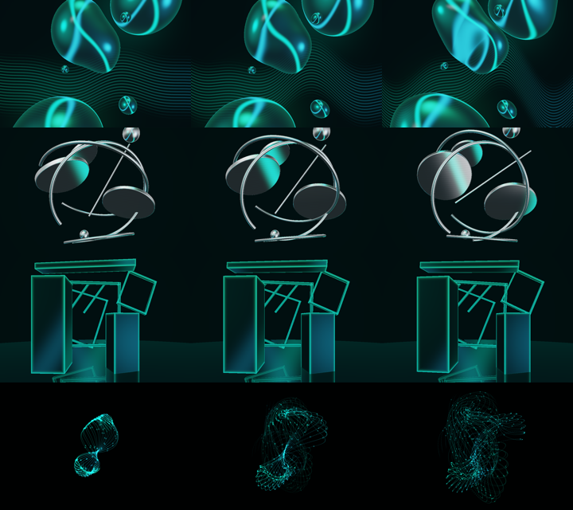
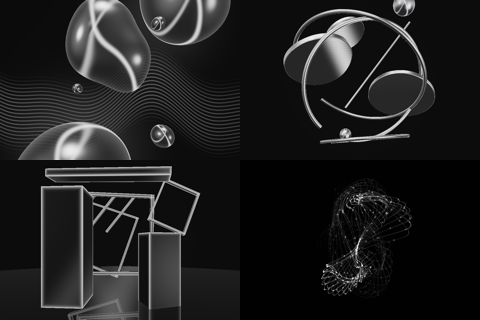

# Apple VibeScape four-family delivery evidence — 2026-11-02

Status: implementation and local qualification in the existing **draft PR295**.
Protected merge, independent exact-head review, installation and product/physical
acceptance are separate gates. Nothing here closes all of Apple #177.

## Delivered behaviour

- Home retains liquid glass lenses, stretching/grouped forms and optional light
  waves. Dynamics affects integrated drift, deformation, wave excursion and the
  interaction between forms.
- Radio uses curved satin-metal discs, open hoops and rods with counterrotation,
  seeded regrouping, light bands and depth. These are procedural sculptures;
  no record/radio bitmap or recoloured blob is used.
- Club uses dark monoliths, spatial frames/planes and lattices, thin emissive
  edges, negative space and floor reflection. Dynamics modulates controlled
  movement, phase patterns and parallax; it is not a single endless tunnel.
- Festival uses coherent 3D filament/point blooms and spiral flows. Dynamics
  affects expansion, curl, evolution and bounded detail. There is no confetti,
  fireworks emitter, strobe or unbounded particle allocation.

The four identities share one Screen/engine/lifecycle and two cached pipelines.
The existing confirmed Session persona/revision selects them; pending, failed,
stale, conflicted or missing authority cannot impersonate another character.
Mood uses existing central palette tokens. Numeric Track Insight is not a
prerequisite and no measured BPM/energy claim is invented.

One effective relative Dynamics state drives both slider and visual speech.
The centre is neutral (1× each family multiplier). Manual visit choices survive
track/Mood/persona changes; temporary spoken track overrides restore the held
visit choice when that track expires. Hold/Undo preserve scope, while reset
uses the current persona. A newer gesture fences older voice responses. Voice
success waits for the exact settled target's actual GPU completion, within the
original source deadline. Unknown persona cannot accept invisible directives.

The existing authenticated context route supplies real opaque occurrence IDs.
Item/progress/timestamp changes never fabricate them. Idle reads are bounded,
source-fenced and retired on exit; same-item replay can supply a new occurrence.
The renderer performs no playback, queue, volume, personal-intelligence,
Profile-settings, ordinary Ask DJ, transcript-history or analytics mutation.

See [the design and full provenance](../design/VIBESCAPE_FAMILIES_V1.md) and
[exact reference bytes/checksums](../design/assets/vibescape-families-v1/manifest.json).
Private Drive access was verified and the actual approved references inspected.

## Actual native images and movement

Rows are Home, Radio, Club, Festival; columns are calm / neutral / intense.
All use the same Groove Mood, synthetic seed and visit duration. GIFs are actual
Metal frames and are never runtime effect assets.

The same four families with a common grey palette (Home/Radio above, Club/Festival
below) distinguish geometry/material rather than persona-specific colouring:

The checked-in [compact native proof](../design/assets/vibescape-families-v1/native-proof.json)
binds the generated images/report to source **and linked Core/JOSESwift object**
hashes. This is explicitly synthetic native Mac GPU evidence, not real Spotify
playback or physical iPhone/iPad acceptance.

Local evidence root:
`/Volumes/Shared Data/tmp/pcvantol/apple-suggestions-more-footer-20261102/`.

- `vibescape-worlds/gpu-shipping-final-r1/renders/`: all 48 scenario PNGs,
  twelve 8-second low/middle/high GIFs, four monochrome PNGs and twenty synthetic
  occurrence/seed images **per family**. `gpu-report.json` records timing,
  sixteen actual pixel-effect checks for colour/depth/roughness/deformation,
  four touch/swipe/expiry checks and 240 rapid-transition frames.
- `vibescape-worlds/gpu-shipping-final-r1/source-receipt.json`: exact compiler
  commands, Xcode version, source and linked-product hashes; unchanged inputs.
- `vibescape-worlds/home-touch-shipping-r1/`: original Home touch-position,
  strength, expiry and 79-sample temporal regression, passing on the final shader.
- `vibescape-worlds/native-controls-final-r2/{iphone,ipad}.xcresult` and exported
  attachment directories: actual Session controls → accepted model → visible
  world, rejected save, explicit microphone denial, freshly reopened Help,
  owner/background withdrawal, five UI languages, large text and real system
  Reduce Motion. Both devices pass all five test methods; each locale case
  additionally exercises five languages. These use synthetic authenticated
  server fixtures and unique disposable app identities/simulators.

The native UI run contains the final Swift/controller/scope implementation.
The subsequent **Metal-only** local-contact addition gives Radio/Club a bounded
light response and Festival coherent filament displacement/glow; it leaves the
Swift controls and authority paths unchanged. The final shader is separately
qualified by the 48/16/4 GPU checks, original Home regression and final app builds.
No physical mobile touch/haptic acceptance is inferred from those checks.

## Validation and compatibility

- Full parallel Swift suite: **1,645 tests in 60 suites pass**;
  `vibescape-worlds-shipping-full-r1.log` and its exact-input receipt.
- Nine required repository check groups pass:
  `validation-vibescape-worlds-shipping-r1/logs-checks/results.json`.
- Final unsigned macOS and iOS/iPadOS plus embedded Watch targets build:
  `vibescape-worlds/build-shipping-r1-receipt.json` and target logs. Source hashes
  remain unchanged during those builds. No ordinary app was installed/launched.
- Accepted/rejected settings fixtures,48 logical states, continuous phase
  sweeps, paused/resumed phase, rapid A→B→C→A, conflict/ABA, stale voice/gesture,
  shared speech/slider state, neutral authority, scope restoration, Undo/Hold,
  budgets and GPU-quality hysteresis are covered by the Swift/GPU tests.
- Xcode 27.2 (`27B52`), macOS 27.2 (`26B123`); iOS 27.0 temporary iPhone 17 Pro and
  iPad Pro 13-inch M5 simulators. Existing app version 4.0.0/deployment settings
  remain; no distribution build number or release is assigned by this change.
- Compatibility uses the existing confirmed Session persona/CAS v1 and closed
  Visual Director context/help/interpret/revoke schema 1 contracts. No new Core
  endpoint, Profile preference or persistence model is introduced. Fixture
  compatibility does not establish an installed Core/provider runtime.

Native offscreen GPU command times on **Apple M6 at 960×640**:

| Family | Median range, ms | Highest scenario p95, ms |
| --- | --- | --- |
| home | 2.03–2.08 | 3.20 |
| radio | 3.10–3.17 | 4.85 |
| club | 4.13–5.18 | 6.51 |
| festival | 0.03–0.08 | 0.35 |

Rapid interrupted mixtures: median **10.65ms**, p95
**12.78ms**. Transition sampling is bounded immediately;
GPU/thermal/low-power reductions do not change the user's Dynamics. These are
command timings under this Mac test workload, not whole-app FPS, exclusive-load
benchmarking, startup latency, sustained thermals or mobile battery acceptance.

## Source/delivery boundary and remaining acceptance

Owning branch: `codex/apple-suggestions-more-footer-20261102`,
[existing draft PR295](https://github.com/pcvantol/djconnect-app/pull/295).
The pickup source was `6c3096ca3e6e372c211830ef75cebf788eae0ae3`, protected main
`10ea3950e01dd0e7bf7b1d4a357ef2d90d34b624`. The frozen publication receipt at
`vibescape-worlds/published-source-r1.json` records the resulting commit and
artifact hashes; hosted CI must be read against that exact published head.
Local results do not substitute for independent source review or Finalization.

Still separate: approved installation of the reviewed build; actual paired Root
and authorised microphone/STT/closed-directive/provider operation; twenty real
provider occurrences including replay; physical iPhone/iPad and whole-Mac
frame/energy/thermal behaviour; real VoiceOver navigation and final artistic
acceptance against the reference images on those screens. Older open #177
requirements remain open. No merge, protected-source bypass, deployment,
TestFlight/App Store publication or ordinary-device installation was performed.
